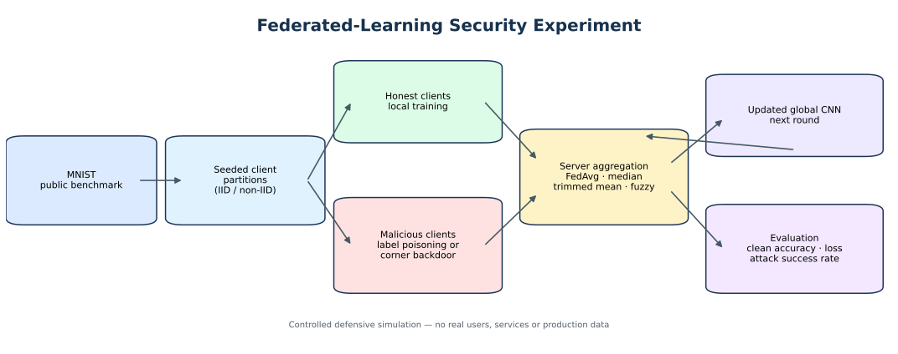

# Robust Federated Learning Under Poisoning and Backdoor Attacks

**Project period: August 2025 – December 2025**

[](https://github.com/MUmairSarwar/robust-federated-learning-ml-security/actions/workflows/tests.yml)

An educational PyTorch study of federated-learning security on MNIST, including controlled label poisoning, a corner-trigger backdoor, robust aggregation baselines and an experimental fuzzy client-reliability weighting method.

> **Status:** implementation complete; benchmark values remain `TBD` until the experiments are run. No numerical results are fabricated.



## Project focus

This project studies how malicious or corrupted clients can influence federated learning and compares server-side aggregation strategies under heterogeneous data, poisoning and backdoor scenarios.

Implemented components include:

- Configurable multi-client CNN simulation
- IID and simple non-IID client partitions
- Label-poisoning and backdoor scenarios
- FedAvg, coordinate-wise median and trimmed-mean aggregation
- Experimental fuzzy client-reliability aggregation
- Clean accuracy and attack-success metrics
- Automated tests, YAML configurations and per-run metrics for reproducibility

## Why it matters

Federated learning allows participants to train a shared model without pooling raw data, but malicious clients can still manipulate model updates. This repository provides a controlled, reproducible environment for studying robust aggregation and adversarial behaviour.

The fuzzy reliability prototype connects uncertainty modelling and optimisation with machine-learning security. It is a research exercise, not a proven security guarantee or a claim of academic novelty.

## Installation

```bash
python -m venv .venv
source .venv/bin/activate
pip install -r requirements.txt
```

## Example runs

```bash
python src/train_centralized.py
python src/main.py --config experiments/baseline_fedavg.yaml
python src/main.py --config experiments/label_poisoning_fedavg.yaml
python src/main.py --config experiments/backdoor_fedavg.yaml
python src/main.py --config experiments/fuzzy_reliability_defense.yaml
```

## Results

For a credible comparison, benchmark configurations should be repeated across multiple seeds and reported with appropriate variability. The repository intentionally leaves the main comparison values as `TBD` until measured runs are available.

| Defense | Attack | Clean accuracy | Attack success rate | Runtime |
|---|---|---:|---:|---:|
| FedAvg | None | TBD | TBD | TBD |
| FedAvg | Label poisoning | TBD | TBD | TBD |
| FedAvg | Backdoor | TBD | TBD | TBD |
| Median | Label poisoning | TBD | TBD | TBD |
| Trimmed mean | Backdoor | TBD | TBD | TBD |
| Fuzzy reliability | Backdoor | TBD | TBD | TBD |

## Technologies

Python, PyTorch, NumPy, pandas, scikit-learn, pytest, federated learning, robust statistics and adversarial ML evaluation.

## Limitations

MNIST is a toy benchmark and is not representative of modern deployed workloads. The simulation assumes synchronous participation and a controlled malicious-client setup. Stronger future work could include larger public datasets, multiple seeds, partial participation, additional robust baselines and adaptive attacks.

## Other selected projects

- [Rhine-Main Heat Risk Forecasting](https://github.com/MUmairSarwar/germany-heat-risk-forecasting)
- [Strategic Classification](https://github.com/MUmairSarwar/strategic-classification-toy)
- [Retail Customer & Operations Analytics](https://github.com/MUmairSarwar/retail-customer-analytics)
- [Telecom Customer Churn Prediction](https://github.com/MUmairSarwar/customer-churn-prediction)

## Author

**Muhammad Umair Sarwar**  
Incoming M.Sc. Mathematics – Mathematics in Data Science student at TU Darmstadt, starting WS 2026/27.  
Available from 1 September 2026 for HiWi / Student Research Assistant roles, up to 20 hours/week.
