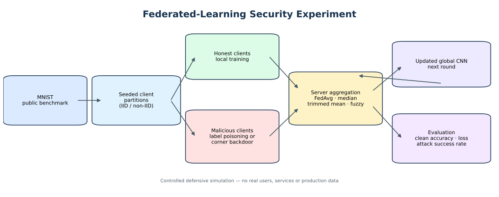

# Robust Federated Learning Under Poisoning and Backdoor Attacks

[](https://github.com/MUmairSarwar/robust-federated-learning-ml-security/actions/workflows/tests.yml)

A small PyTorch study of how a few malicious clients can influence federated learning on MNIST, and how much server-side aggregation rules help. It compares FedAvg, coordinate-wise median, trimmed mean and an experimental fuzzy client-reliability weighting under label flipping and a corner-trigger backdoor. Everything runs as a single-process simulation.

I developed the project locally from August to December 2025 and committed it to GitHub in July 2026. The multi-seed benchmark was added in August 2026.



## Setup

The defaults below are used by every benchmark configuration in [`experiments/`](experiments/).

| | |
|---|---|
| Data | MNIST via `torchvision`, pixel values in [0, 1], no normalisation |
| Clients | 10, IID split of the 60,000 training images (a label-sorted non-IID split is available but not benchmarked) |
| Model | CNN with two 3×3 convolution layers (16 and 32 channels) with max pooling, then 64 hidden units and 10 outputs |
| Training | 10 rounds; each client does 1 local epoch of SGD (lr 0.01, momentum 0.9, batch size 64) and returns its parameter change |
| Malicious clients | clients 0, 1 and 2 (fraction 0.3), fixed for the whole run and unknown to the server |
| Label flipping | each malicious client relabels half of the digit-1 images in every batch as 7 |
| Backdoor | each malicious client stamps a white 3×3 square in the bottom-right corner of half of every batch and relabels those images as 0 |

**Metrics.** Clean accuracy is measured on the 10,000 MNIST test images. For the backdoor, the attack success rate (ASR) is the share of triggered test images whose true label is not 0 that the model classifies as 0. For label flipping, it is the share of test images of digit 1 classified as 7.

## Aggregation rules

With client updates $\Delta_1, \dots, \Delta_n$:

- **FedAvg:** $\sum_k \frac{m_k}{\sum_j m_j} \Delta_k$, with $m_k$ the client's sample count.
- **Coordinate-wise median:** the median of the $n$ values at every parameter.
- **Trimmed mean:** at every parameter, sort the $n$ values, drop $\lfloor n \cdot 0.2 \rfloor$ from each end and average the rest.
- **Fuzzy reliability (experimental):** for each client, three indicators in $[0, 1]$ are computed from the flattened update: how close its norm is to the median norm and how close it is to the mean update (both through a logistic function of a median/MAD-scaled deviation), and its cosine similarity with the mean update mapped from $[-1, 1]$ to $[0, 1]$. The membership degree $\mu_k$ is their average, the non-membership degree is $\nu_k = 1 - \mu_k$, and the weights are $\mathrm{softmax}(\mu_k - \nu_k)$.

Details are in [`docs/methodology.md`](docs/methodology.md) and [`src/defenses/`](src/defenses/).

## Results

Final-round values, mean ± standard deviation over seeds 42, 43 and 44. Per-run values are in [`results/benchmark_runs.csv`](results/benchmark_runs.csv), per-round histories in [`results/benchmarks/tables/`](results/benchmarks/tables/). The runs were produced by the [benchmark workflow](.github/workflows/benchmark.yml) on a GitHub Actions CPU runner ([experiment log](docs/experiment_log.md)).

| Aggregation | Attack | Clean accuracy | Attack success rate |
|---|---|---:|---:|
| FedAvg | none | 97.66% ± 0.15 | 0.00% ± 0.00 |
| FedAvg | label flipping | 97.61% ± 0.09 | 0.15% ± 0.13 |
| Median | label flipping | 97.61% ± 0.05 | 0.03% ± 0.05 |
| FedAvg | backdoor | 97.55% ± 0.13 | 98.99% ± 0.26 |
| Trimmed mean | backdoor | 97.57% ± 0.12 | 92.65% ± 2.80 |
| Fuzzy reliability | backdoor | 97.68% ± 0.12 | 91.97% ± 3.52 |

Clean accuracy is about 97.6% in every setting, so none of the attacks is visible from accuracy alone.

**Label flipping barely works here.** Three of ten clients flip half of their 1s, so only about 15% of all digit-1 labels in the federation are wrong, and the honest majority dominates even under plain FedAvg.

**The backdoor works, and neither defence stops it.** Under FedAvg the trigger succeeds on 99% of test images. Trimmed mean and the fuzzy rule bring this down only to about 92%. Two features of the setup explain part of that:

- Trimmed mean with $n = 10$ and ratio 0.2 removes two values from each end of every coordinate. With three attackers, at least one malicious value can survive at every coordinate.
- In the fuzzy rule $\nu_k = 1 - \mu_k$ exactly, so the uncertainty degree $1 - \mu_k - \nu_k$ is always zero and the score $\mu_k - \nu_k = 2\mu_k - 1$ lies in $[-1, 1]$. Softmax over such scores can give one client at most $e^2 \approx 7.4$ times the weight of another. In the stored diagnostics ([`*_reliability.csv`](results/benchmarks/tables/)) the three malicious clients received on average about 18% of the total weight per round across the three seeds, against 30% under equal weights. They are down-weighted, but not enough to remove the backdoor.

These results come from one dataset, one model and one attack strength. They say little about how the rules would behave elsewhere.

## Run

```bash
python -m venv .venv
source .venv/bin/activate
pip install -r requirements.txt
python -m pytest -q
python src/main.py --config experiments/quick_demo.yaml --smoke-test   # tiny 2-client, 1-round run
python src/main.py --config experiments/backdoor_fedavg.yaml           # one full experiment
python src/train_centralized.py                                        # centralised reference model
```

MNIST is downloaded to `data/` on the first run. Each experiment writes per-round metrics (and, for the fuzzy rule, per-client diagnostics) to `results/tables/`, named after the experiment, and plots to `results/figures/`. The plot file names are fixed, so they always show the most recent run. A conda environment file is also provided ([`environment.yml`](environment.yml)).

## Repository structure

```text
src/main.py              run one experiment from a YAML config
src/federated/           client training and the round loop
src/defenses/            FedAvg, median, trimmed mean, fuzzy reliability
src/attacks/             label flipping and backdoor trigger
src/evaluation/          accuracy, attack success rate, plots
experiments/             YAML configurations
results/                 committed benchmark tables
docs/                    methodology, project report, experiment log, architecture figure
tests/                   aggregation, fuzzy weights and client partitioning
```

## Limitations and next steps

- MNIST with a small CNN is an easy benchmark, and the attacks are fixed rather than adaptive.
- All clients take part in every round and the malicious clients are the same throughout.
- Only three seeds were run. Configurations for the median under the backdoor and trimmed mean under label flipping exist in `experiments/` but are not part of the benchmark yet.
- The fuzzy rule compares clients with the mean update, which the attackers themselves shift. Its uncertainty degree is currently always zero. Using independent evidence for non-membership, so that the uncertainty degree carries information, is the obvious next step.
- Further extensions: Dirichlet non-IID splits, partial participation, stronger baselines such as Krum or norm clipping, and a larger dataset.

The fuzzy rule is a heuristic I wanted to try, not a proven defence or a claim of novelty. All attacks are contained simulations on MNIST for defensive study.

## Author

Muhammad Umair Sarwar, M.Sc. Mathematics (Mathematics in Data Science), TU Darmstadt. Other projects are listed on my [GitHub profile](https://github.com/MUmairSarwar).

Licence: MIT, see [LICENSE](LICENSE).
